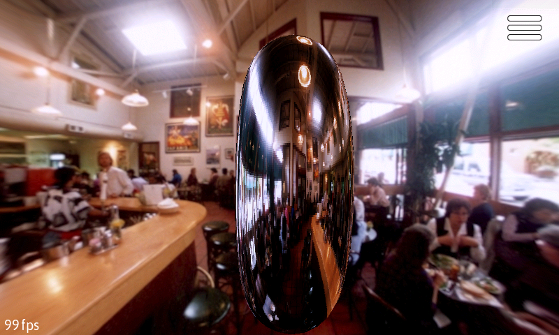

# TouchGFX projects

Embedded touchscreen projects for the **STM32F769I-DISCO**: a two-player chess clock and interactive framebuffer effects.

[Explore the chess clock](ChessClock/readme.md) · [Open the Designer project](ChessClock/TouchGFX/ChessClock.touchgfx) · [Printable enclosure](ChessClock/enclosure/)

[Explore the framebuffer demo](framebuffer_demo/README.md) · [Open its Designer project](framebuffer_demo/TouchGFX/framebuffer_demo.touchgfx) · [Review and modernization notes](framebuffer_demo/docs/modernization.md)

## Chess clock

Each half of the display acts as one player's clock button. Tap your own half to finish a move and start the other clock. The active side is highlighted; the clock changes color as time runs low.

- Eight time-control presets, custom time and Fischer increments
- Unlimited count-up mode for casual play
- Pause, resume and reset from the touchscreen
- A monotonic millisecond time base on both the board and the desktop simulator
- A printable enclosure and optional 10-degree desk stand

## Framebuffer demo

Three effects combine direct RGB565 rendering with touch interaction:

- Fluid smoke with three rendering quality levels
- An environment-mapped 3D torus with three mesh resolutions
- Animated polygon rings that follow the pointer

The demo includes native regression tests and a simulator self-test for screen
transitions, input lifecycle and clipped redraws. It currently uses **TouchGFX
4.17.0**; the chess clock uses **4.26.1**. Each project keeps its own SDK and
generated output local. See the [demo guide](framebuffer_demo/README.md) for setup
and the planned upgrade. Simulator preview FPS values are not performance measurements.

## Open and build

1. Install TouchGFX 4.26.1 and open [`ChessClock/TouchGFX/ChessClock.touchgfx`](ChessClock/TouchGFX/ChessClock.touchgfx) in TouchGFX Designer.
2. Generate code and run the desktop simulator to explore the interface.
3. For the board, build the target and flash it with STM32CubeProgrammer.

See the [chess clock guide](ChessClock/readme.md#building) for command-line builds, supported IDE projects, board configuration and enclosure printing notes, and the [framebuffer demo guide](framebuffer_demo/README.md) for its separate setup. Generated GUI/assets, build output and the TouchGFX framework are excluded from both projects. The older demo retains its maintained simulator/build entry points and self-tests.

Time-control settings reset on power-up. The enclosure fit has not yet been verified on hardware; see the [enclosure notes](ChessClock/readme.md#enclosure) before printing.
