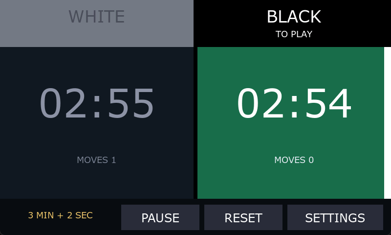
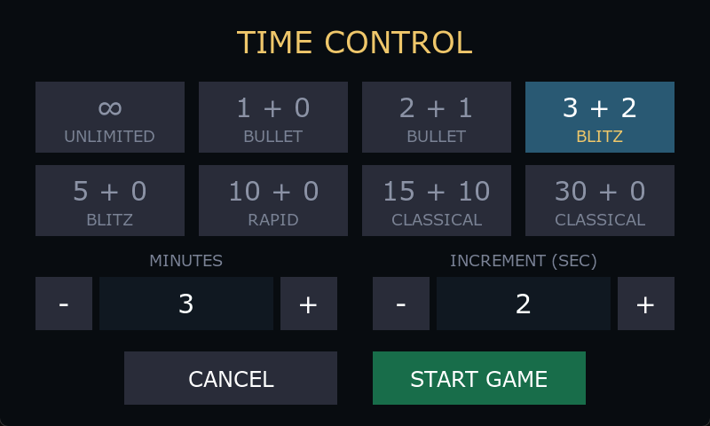

# TouchGFX projects

Embedded touchscreen projects for STM32 development boards. The current project is a two-player chess clock for the **STM32F769I-DISCO**, built with **TouchGFX 4.26.1**.

[Explore the chess clock](ChessClock/readme.md) · [Open the Designer project](ChessClock/TouchGFX/ChessClock.touchgfx) · [Printable enclosure](ChessClock/enclosure/)

## Chess clock

Each half of the display acts as one player's clock button. Tap your own half to finish a move and start the other clock. The active side is highlighted; the clock changes color as time runs low.

- Eight time-control presets, custom time and Fischer increments
- Unlimited count-up mode for casual play
- Pause, resume and reset from the touchscreen
- A monotonic millisecond time base on both the board and the desktop simulator
- A printable enclosure and optional 10-degree desk stand

## Open and build

1. Install TouchGFX 4.26.1 and open [`ChessClock/TouchGFX/ChessClock.touchgfx`](ChessClock/TouchGFX/ChessClock.touchgfx) in TouchGFX Designer.
2. Generate code and run the desktop simulator to explore the interface.
3. For the board, build the target and flash it with STM32CubeProgrammer.

See the [project guide](ChessClock/readme.md#building) for command-line builds, supported IDE projects, board configuration and enclosure printing notes. Generated code and the TouchGFX framework are recreated by the tools rather than stored here.

Time-control settings reset on power-up. The enclosure fit has not yet been verified on hardware; see the [enclosure notes](ChessClock/readme.md#enclosure) before printing.
