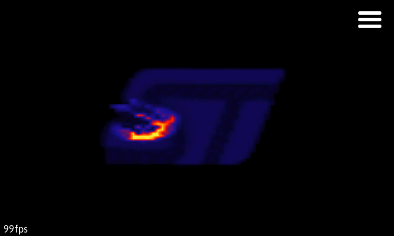

# Framebuffer demo

TouchGFX 4.17 demo for the STM32F769I Discovery board, with a Windows simulator.

The three effects are a fluid smoke simulation, an environment-mapped 3D torus,
and animated polygon rings that follow touch input.



[Torus preview](doc/torus.png) · [Polygon rings preview](doc/shapes.png)

These snapshots come from automated simulator checks; displayed FPS values are
not performance measurements.

## First-time setup

This project remains on **TouchGFX 4.17.0** while the chess clock in the same
repository uses **4.26.1**. Do not mix generated output or framework libraries
between these versions. The [modernization plan](docs/modernization.md) describes
the pending framework migration.

Generated GUI/assets and the TouchGFX SDK are excluded from Git, matching the
other project's repository conventions. The local development copy may already
contain them. For a fresh checkout:

1. Obtain the official TouchGFX 4.17.0 package and place its framework at
   `Middlewares/ST/touchgfx/` within this project.
2. Open `TouchGFX/framebuffer_demo.touchgfx` in TouchGFX Designer 4.17 and generate
   GUI code, images, fonts and texts. Generation requires the matching TouchGFX
   environment; cached assets alone are not included in the repository.
3. Run `python tools/normalize_gui_filenames.py` to normalize references to the
   lowercase application files. Review `git diff` after generation and preserve
   the maintained simulator entry point, MSBuild project, properties and targets.
4. Run the native tests, then build and test the simulator as described below.

The current changes have been checked using locally restored 4.17 dependencies.
Fresh generation with a new Designer installation still needs verification.

## Run the simulator

Requires Visual Studio 2022 (Community or Build Tools) with **Desktop development
with C++**, the **MSVC v143** tools, and a Windows 10/11 SDK.

From PowerShell in this folder:

```powershell
.\run-simulator.ps1
```

Close the simulator before rebuilding. For a debug build, use
`.\run-simulator.ps1 -Configuration Debug`. To build without launching, add `-NoRun`.
The executable and its runtime DLLs are placed in
`TouchGFX/build/Release/bin/` (or `Debug/bin/`). You can also open
`TouchGFX/simulator/msvs/Application.sln` and build for **Win32**.

The simulator uses the local TouchGFX framework, its VS 2019 runtime libraries,
and locally generated images, fonts, and texts. Once generated, the default build
does not need the old TouchGFX Ruby environment. If you change design assets, regenerate
them with TouchGFX Designer 4.17 before rebuilding. The original asset conversion
targets remain available with `/p:RegenerateAssets=true` when the TouchGFX 4.17
environment path in `TouchGFX/config/msvs/Application.props` is configured.

Simulator shortcuts: **Escape** exits; **F3** saves a screenshot.

## Development

Application-owned files under `TouchGFX/gui` and the target touch adapter use
lowercase filenames and includes.
After TouchGFX Designer regenerates code, run:

```powershell
python tools/normalize_gui_filenames.py
.\tests\run-tests.ps1
.\tests\run-tests.ps1 -Simulator -Configuration Debug
```

Generated filenames and ST library filenames retain their original casing.
The native tests run without the TouchGFX SDK using a small touch-interface stub,
the actual application adapter and the bundled FT6x06 component driver with a mocked HAL.
The simulator test runs in a temporary hidden window and exits. It builds into
`TouchGFX/build/selftest/Debug/bin/` and writes `self-test.log` plus framebuffer
snapshots there. Use `-Configuration Release` to validate the optimized build.
See [the review and modernization plan](docs/modernization.md) for fixed bugs,
remaining renderer work and the staged upgrade to current TouchGFX.
